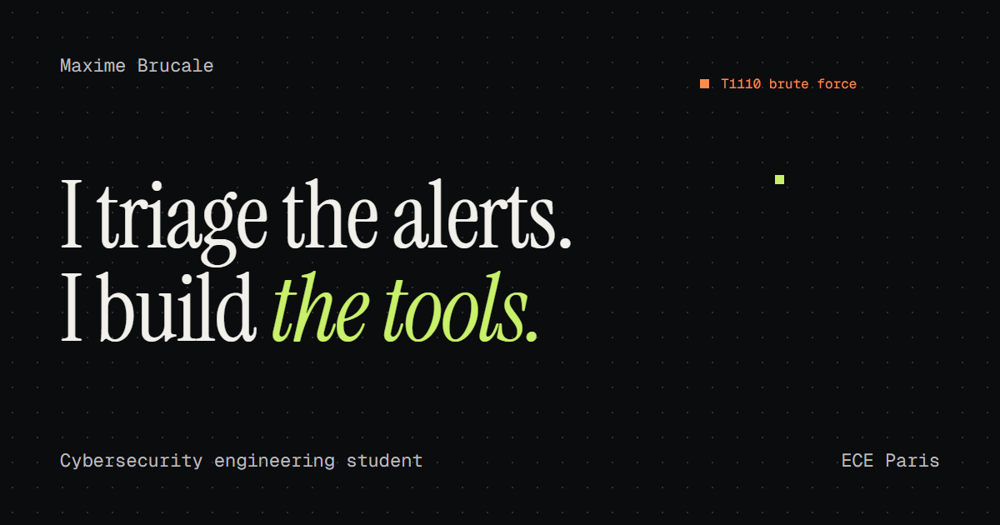

# Maxime Brucale, portfolio

Personal site of a cybersecurity engineering student at ECE Paris, available in French and English.

**Live site:** <https://myportfolio-mbrucale.vercel.app>



## What's inside

- **A main page built for a quick read:** who I am, when I'm available, my experience, my projects and how to reach me.
- **A case study per flagship project:** the problem, the answer, the numbers and the screenshots.
- **A detection field in the hero:** alerts labeled with real MITRE ATT&CK techniques appear on a canvas, and hovering one triages it.
- **A decoy page at `/admin`:** a nod to the HoneyLink project. `robots.txt` points curious visitors to it, and nothing is sent or stored.
- **Two languages and two resumes:** every page exists under `/fr` and `/en`, with a matching PDF resume.

## Tech stack

| Area | Choice |
| --- | --- |
| Framework | Next.js 16 (App Router, static generation) |
| Language | TypeScript, React 19 |
| Styling | Tailwind CSS 4 |
| Fonts | Instrument Serif, Geist and Geist Mono, self-hosted through `next/font` |
| Animation | CSS and the Canvas API, with no animation library |
| Contact form | Formspree |
| Hosting and analytics | Vercel |

## Getting started

You need Node.js 20.9 or later.

```bash
npm install
npm run dev
```

The site then runs on <http://localhost:3000>.

| Command | What it does |
| --- | --- |
| `npm run dev` | Starts the development server |
| `npm run build` | Builds the production site |
| `npm start` | Serves the production build |
| `npm run lint` | Runs ESLint |
| `npm run assets` | Rebuilds the resumes and the social images (Windows with Microsoft Edge) |

## Project structure

```text
app/
  [lang]/                  Pages for each language
    page.tsx               Main page
    projects/[slug]/       Case study pages
    admin/                 Decoy page
  global-not-found.tsx     404 page
  sitemap.ts               Sitemap
components/                Interface components
content/site.ts            All the text and project data, in both languages
cv/                        Resume sources (HTML and CSS)
scripts/                   Generation of the resumes and social images
public/                    Images, videos, PDF files, robots.txt and security.txt
next.config.ts             Redirects and security headers
```

## Editing the content

All the text lives in [`content/site.ts`](content/site.ts), with one object per language. TypeScript checks that both languages have the same structure, so a missing translation breaks the build.

**To add a flagship project:**

1. Put its images in `public/projects/`.
2. Add an entry to `projects.list` in both the `fr` and `en` objects, with the same `slug`.

The main page, the case study page and the sitemap pick it up automatically.

**Once a project's code goes public:** replace `codeNote` with a `repo` link in its entry.

**Once a certification is obtained:** remove `inProgress` from its entry and add its date and link.

## Resumes and social images

| Output | Source |
| --- | --- |
| `public/Maxime_Brucale_CV_FR.pdf` | `cv/fr.html` and `cv/style.css` |
| `public/Maxime_Brucale_CV_EN.pdf` | `cv/en.html` and `cv/style.css` |
| `public/og-fr.png`, `public/og-en.png` | `scripts/og.html` |

After changing a source, run `npm run assets`, then check that each resume still fits on one page. The public resumes deliberately leave out my phone number and postal address.

## Security

The site is static and collects no data of its own. The contact form posts directly to Formspree and includes a hidden field that traps spam bots.

- **Headers:** Content Security Policy, HSTS, `X-Frame-Options`, `X-Content-Type-Options`, `Referrer-Policy`, `Cross-Origin-Opener-Policy` and `Permissions-Policy`, all defined in [`next.config.ts`](next.config.ts) and applied in production.
- **Known limit:** `script-src` keeps `'unsafe-inline'`, because Next.js static pages use inline scripts and nonces would require rendering each page on the server.
- **Vulnerability reports:** see [`security.txt`](public/.well-known/security.txt).

## Design notes

- **Accessibility:** animations respect `prefers-reduced-motion`, the pages can be used with a keyboard and the hero canvas is hidden from screen readers.
- **Performance:** the hero canvas only redraws what changes, runs at about 30 frames per second and stops when it leaves the screen. Demo videos load only when they are opened.
- **Page structure:** each page has a single root element through `components/PageShell.tsx`. With `scroll-padding-top` set, several root elements make Next.js jump to the footer on client navigation.

## Deployment

Vercel deploys `main` to production on every push, and other branches get a preview URL. No environment variables are needed.

## Contact

- Email: [maxime.brucale@edu.ece.fr](mailto:maxime.brucale@edu.ece.fr)
- LinkedIn: [Maxime Brucale](https://www.linkedin.com/in/maxime-brucale-b77041294/)
- Root-Me: [Zeruel734](https://www.root-me.org/Zeruel734)
- LetsDefend: [zeruel734](https://app.letsdefend.io/user/zeruel734)
